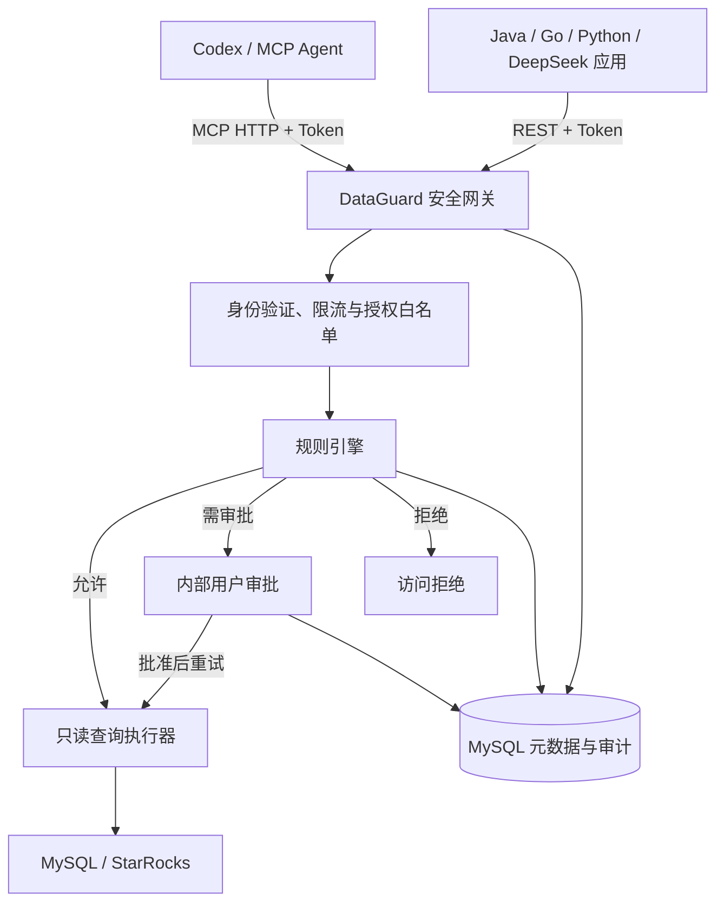

# DataGuard

**面向 AI Agent 的数据库安全访问平台**，统一提供 **MCP Streamable HTTP** 与 **RESTful API**，让 Codex、自建 Agent、Java、Go、Python 和基于 DeepSeek 的应用通过受控接口读取 MySQL / StarRocks，而非持有数据库账号直接访问。

> 当前开发分支：[`feature/ai-access-gateway-v1`](https://github.com/NJgaoyang/DataGuard/tree/feature/ai-access-gateway-v1)。本 README 适用于该分支。项目为独立实现，不依赖旧 MCP-DataGuard 仓库。

## 功能

- **双协议**：`POST /mcp` 与 `/api/v1/agent/**` 使用相同 Agent Bearer Token、白名单、规则引擎与 JDBC 执行链。
- **分级授权**：数据源、表、字段白名单以及 Agent 专属授权取交集；默认拒绝。
- **只读保护**：后端生成受限单表 `SELECT`，不提供任意 SQL、DDL、DML、JOIN；单次读取行数默认最多 200 行，管理员可在安全设置内调整。
- **访问审批**：规则可设置放行、拒绝或人工审批；通过后重试完全相同的查询，单次审批不可重复消费。
- **安全审计**：记录 Agent、请求、规则、审批和操作审计，不持久化查询返回的业务数据。
- **管理控制台**：数据源、Agent、访问规则、审批中心、访问记录、用户和安全参数。

## 系统架构



两个外部入口共享 Token 校验、平台/Agent 表字段权限、规则、审计和查询执行；**管理员拥有管理能力并不意味着每个 Agent 自动拥有全部数据库读取权限**。

## 技术栈

| 层次 | 技术 |
|---|---|
| 后端 | Java 21、Spring Boot 3.5、Spring Security、Spring JDBC |
| 前端 | Vue 3、TypeScript、Vite 7、Ant Design Vue 4、Vue Router |
| 元数据存储 | MySQL 8.4、Flyway |
| 业务数据源 | MySQL、StarRocks（MySQL 协议） |
| 部署 | 单体 Spring Boot JAR、systemd；无需 Docker |
| 外部接入 | MCP Streamable HTTP（JSON 响应）和 REST JSON API |

## 快速部署与首次使用

1. 准备 Java 21、Maven、Node.js、MySQL 8，并创建独立的 DataGuard 元数据库及最小权限账号。
2. 配置环境变量：`DG_MYSQL_URL`、`DG_MYSQL_USER`、`DG_MYSQL_PASSWORD`、`DG_ENCRYPTION_KEY`（32 字节随机密钥的 Base64）、`DG_INITIAL_ADMIN_PASSWORD`（初始复杂密码）、`DG_ALLOWED_SOURCE_HOSTS`（允许访问的数据库主机）；HTTPS 环境设置 `DG_SECURE_COOKIE=true`。
3. 克隆指定分支、打包运行：

```bash
git clone -b feature/ai-access-gateway-v1 https://github.com/NJgaoyang/DataGuard.git
cd DataGuard/frontend
npm ci
npm run build
cd ..
mvn clean package
java -jar target/dataguard-1.0.0-SNAPSHOT.jar
```

4. 用 `admin` 首次登录并修改初始密码。在**数据源**配置物理只读账号并开启表、字段权限；在 **Agent 管理**新建 Agent、复制仅展示一次的 Token 并设置独立授权；在**访问规则**中设定放行/审批/拒绝条件；最后使用以下任一客户端接入。
5. 在**审批中心**处理需要人工批准的访问，在**访问记录**中检查请求与审计。

> 请勿将数据库密码、加密密钥或 Agent Token 放入仓库。正式接入要求 HTTPS 有效证书及数据库 TLS/最小权限配置；开发机演示并不等于生产认证。

## 接入地址与认证

设置环境变量 `DATAGUARD_TOKEN` 为平台新建 Agent 时得到的 `dg_...` Token。所有客户端共享地址，**身份由 Token 决定**。

| 协议 | 示例地址 | 用途 |
|---|---|---|
| MCP | `https://110.42.132.44/mcp` | 支持 MCP 的客户端 |
| REST | `https://110.42.132.44/api/v1/agent` | Java / Go / Python、自建 Agent、DeepSeek 桥接应用 |

以上 IP 为**开发测试站示例**，生产使用时替换为自己的 HTTPS 域名；客户端必须正常校验证书。HTTP Header：`Authorization: Bearer <DATAGUARD_TOKEN>`。

## MCP 接入

**Codex CLI** 可直接添加 HTTP MCP 服务：

```bash
export DATAGUARD_TOKEN='dg_替换成自己的令牌'
codex mcp add dataguard --url https://110.42.132.44/mcp --bearer-token-env-var DATAGUARD_TOKEN
codex mcp list
```

Windows PowerShell 环境变量示例：`$env:DATAGUARD_TOKEN = 'dg_替换成自己的令牌'`。

其他兼容 MCP Streamable HTTP 的客户端可配置：服务器 URL `/mcp`、Header `Authorization: Bearer dg_...`。各客户端配置格式不同；本项目目前验证过 JSON-RPC HTTP 请求，**不保证全部第三方 MCP SDK、SSE 扩展兼容**。

测试 MCP 工具列表：

```bash
curl -X POST 'https://110.42.132.44/mcp' \
  -H "Authorization: Bearer $DATAGUARD_TOKEN" \
  -H 'Content-Type: application/json' \
  -d '{"jsonrpc":"2.0","id":1,"method":"tools/list","params":{}}'
```

MCP 提供六个工具：list_datasources、get_schema、describe_table、validate_sql、execute_sql_readonly、get_access_request。所有查询使用统一 SQL AST 安全引擎。

## RESTful API 接入

| 方法 | 路径（基于 `/api/v1/agent`） | 用途 |
|---|---|---|
| GET | `/datasources` | 列出授权数据源 |
| GET | `/datasources/{id}/tables` | 列出授权表 |
| GET | `/datasources/{id}/tables/{table}/columns` | 列出授权字段 |
| POST | `/queries` | 授权 SQL SELECT（包含计算和 JOIN） |
| POST | `/queries/validate` | SQL AST 权限校验 |
| GET | `/requests/{id}` | 获取审批状态 |

```bash
curl -X POST 'https://110.42.132.44/api/v1/agent/queries' \
  -H "Authorization: Bearer $DATAGUARD_TOKEN" \
  -H 'Content-Type: application/json' \
  -d '{"sourceId":"替换为数据源UUID","sql":"SELECT order_id, amount FROM orders ORDER BY order_id LIMIT 10"}'
```

REST 响应直接为 JSON 数据；命中审批时返回 `status=PENDING`、`requestId`，调用方可查询 `/requests/{id}`，审批通过后重试**完全相同**的查询。无匹配放行规则时默认拒绝。

### Java 21

以下示例读取该 Agent 有权访问的数据源，无需第三方 HTTP 包：

```java
import java.net.URI;
import java.net.http.*;

public class DataGuardExample {
    public static void main(String[] args) throws Exception {
        String token = System.getenv("DATAGUARD_TOKEN");
        HttpClient client = HttpClient.newHttpClient();
        HttpRequest request = HttpRequest.newBuilder(
                URI.create("https://110.42.132.44/api/v1/agent/datasources"))
            .header("Authorization", "Bearer " + token)
            .GET().build();
        HttpResponse<String> response = client.send(request, HttpResponse.BodyHandlers.ofString());
        System.out.println(response.statusCode() + ": " + response.body());
    }
}
```

### Go

```go
package main

import (
    "fmt"
    "io"
    "net/http"
    "os"
)

func main() {
    req, err := http.NewRequest("GET", "https://110.42.132.44/api/v1/agent/datasources", nil)
    if err != nil { panic(err) }
    req.Header.Set("Authorization", "Bearer " + os.Getenv("DATAGUARD_TOKEN"))
    client := &http.Client{}
    resp, err := client.Do(req)
    if err != nil { panic(err) }
    defer resp.Body.Close()
    body, err := io.ReadAll(resp.Body)
    if err != nil { panic(err) }
    fmt.Printf("HTTP %d: %s\n", resp.StatusCode, body)
}
```

### Python

```python
# pip install requests
import os
import requests

base = "https://110.42.132.44/api/v1/agent"
headers = {"Authorization": "Bearer " + os.environ["DATAGUARD_TOKEN"]}
response = requests.get(base + "/datasources", headers=headers, timeout=15)
response.raise_for_status()
print(response.json())

# 将 sourceId 替换成上面列出的有效数据源 UUID，再查询已授权字段：
response = requests.post(
    base + "/queries",
    headers=headers,
    json={"sourceId": "替换为数据源UUID", "tableName": "orders",
          "columns": ["order_id", "amount"], "limit": 10},
    timeout=15,
)
response.raise_for_status()
print(response.json())
```

### DeepSeek / 其他模型

DeepSeek 模型 API 的 Function Calling 由**你的应用**转为上述 REST 请求。模型本身无需持有数据库凭据；应用端保存 Agent Token、执行请求并将返回结果交给模型。审批状态也由应用轮询处理。

## 权限与安全须知

- 平台表/字段白名单与 Agent 授权必须同时满足；只接受经 AST 权限校验的只读 SQL SELECT。
- 数据源账号必须是物理只读账号，数据库连接地址需在 `DG_ALLOWED_SOURCE_HOSTS` 中。
- Token 仅展示一次，失效、停用、撤销后不能继续调用；重新激活撤销 Agent 将重新签发 Token。
- REST 与 MCP 共用访问规则、限流、脱敏、审批与审计逻辑。审批是**单次授权**，不代表扩大 Agent 权限。
- 业务源查询返回值不会持久化到平台审计记录。

更多资料：[REST 接口文档](docs/REST_AGENT_API.md) · [详细系统架构](docs/ARCHITECTURE.md) · [开发机真实业务联调](docs/P0_LIVE_ACCEPTANCE.md)。

## MCP 与 REST 统一 SQL 查询

- MCP 使用 execute_sql_readonly，REST 使用 POST /queries；校验使用 validate_sql 和 POST /queries/validate。
- 通过 SQL SELECT 支持受控 COUNT(*)、聚合、表达式和两表 JOIN，不再提供旧 READ/COUNT/AGGREGATE 三套 API。
- 全部表、字段、函数需通过 AST 和授权校验，审批由实际 SQL 查询触发并仅允许单次消费。
- 详见 [SQL 查询说明](docs/SQL_QUERY_V2.md) 与 [REST Agent API](docs/REST_AGENT_API.md)。
