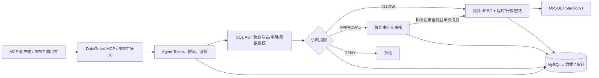

# DataGuard

**面向 AI Agent 的数据库只读安全访问网关**。通过标准 MCP Streamable HTTP 或 REST API，让 AI 助手与业务应用在**受控授权、规则审批、行数限制和审计**的前提下查询 MySQL / StarRocks，而不直接持有业务数据库账号。

> **代码基线：`main`。** 文档描述当前主分支的实现（Flyway V1–V8），不是早期 P0 方案或旧的固定查询接口。开发演示环境：[DataGuard](https://110.42.132.44/)；示例公网 IP 不代表生产域名或生产安全验收。

## 已实现的核心功能

| 领域 | 当前能力 |
|---|---|
| MCP | 官方 Java MCP SDK **0.18.2**，无状态 Streamable HTTP `POST /mcp`，六个工具；支持 `2025-03-26`、`2025-06-18`、`2025-11-25` 协议版本 |
| REST | `/api/v1/agent/**`：授权数据源、表/列目录、SQL 校验、SQL 查询、审批状态 |
| SQL | 只读 `SELECT`、聚合与表达式、`GROUP BY/HAVING/ORDER BY`、参数绑定、**同源最多两张不同物理表 JOIN**，严格 AST 白名单 |
| 数据源 | MySQL、StarRocks（MySQL 协议）；数据库物理只读账号、平台表/字段授权和 Agent 独立授权求交集 |
| 规则与审批 | `ALLOW / DENY / APPROVAL`，默认拒绝；审批人独立审核、相同 SQL 与参数重试、批准单次消费 |
| Agent | 仅「启用 / 已停用」两种运行状态；启用中不能编辑授权/删除；停用后可编辑、启用、软删除；独立 Token 轮换 |
| 审计 | 请求结果、审批、操作审计；新增**脱敏 SQL 模板**（不保存绑定值及查询返回数据） |
| 管理控制台 | 工作台、数据源、Agent 管理、访问规则、审批中心、访问记录、系统设置；按角色和权限显示 |
| 部署与测试 | Java 21 + Spring Boot 3.5、Vue 3 + Ant Design Vue 4、MySQL 8.4 + Flyway V1–V8、CI 的 Maven 和 Playwright 验收 |

**不支持的范围：** 任意 SQL/DML/DDL、跨数据源 JOIN、子查询/CTE/UNION/窗口函数、`SELECT *` 列展开、内置 OAuth 2.1 授权服务器、MCP SSE 推送/会话恢复。运行于单体应用，不是集群化生产 HA 系统。

## 体系结构



管理后台的登录会话与外部 Agent Bearer Token **分别认证**。管理员可以维护策略，但新 Agent 并不会自动获得任何业务表字段的读取权限。

## 本地启动

准备 Java **21**、Maven、Node.js **22**、MySQL **8.x**（开发 CI 使用 8.4），并为平台元数据创建独立数据库与账号。

```bash
git clone https://github.com/NJgaoyang/DataGuard.git
cd DataGuard
cd frontend && npm ci && npm run build && cd ..
mvn -B -ntp clean package
```

配置运行环境中的 `DG_MYSQL_URL`、`DG_MYSQL_USER`、`DG_MYSQL_PASSWORD`、`DG_ENCRYPTION_KEY`、`DG_INITIAL_ADMIN_PASSWORD`、`DG_ALLOWED_SOURCE_HOSTS`，然后：

```bash
java -jar target/dataguard-1.0.0-SNAPSHOT.jar
```

默认只绑定 `127.0.0.1:8080`；Flyway 启动时按顺序执行 V1–V8。浏览器登录使用首次初始化的 `admin`，必须修改初始密码，然后依次配置**数据源 → 平台表/字段白名单 → Agent 授权 → 访问规则**。详情见 [安装与快速开始](docs/GETTING_STARTED.md)。

> **安全提示：** 所有密钥/数据库凭据应从环境或受保护的配置注入，不要提交到 GitHub；公网使用可信 HTTPS/TLS、最小权限账号和独立备份。开发演示站不能直接作为生产安全认证。

## 外部 Agent 调用

在「Agent 管理」创建 Agent，安全保存**只展示一次**的 Token，并授予相应数据源、表、字段，再添加可匹配的访问规则。

### REST：验证与执行 SQL

```bash
export DATAGUARD_TOKEN='替换为实际 Agent Token'
export DATAGUARD_URL='https://110.42.132.44'

curl -X POST "$DATAGUARD_URL/api/v1/agent/queries/validate" \
  -H "Authorization: Bearer $DATAGUARD_TOKEN" \
  -H 'Content-Type: application/json' \
  -d '{"sourceId":"替换为数据源 UUID","sql":"SELECT COUNT(*) AS total FROM orders LIMIT 1","params":[]}'

curl -X POST "$DATAGUARD_URL/api/v1/agent/queries" \
  -H "Authorization: Bearer $DATAGUARD_TOKEN" \
  -H 'Content-Type: application/json' \
  -d '{"sourceId":"替换为数据源 UUID","sql":"SELECT COUNT(*) AS total FROM orders LIMIT 1","params":[]}'
```

若命中人工审批，会返回 `PENDING` 与 `requestId`：审批完成后按**相同 SQL、参数和权限范围**重新提交请求。SQL/REST 具体限制见 [REST Agent API](docs/REST_AGENT_API.md) 和 [SQL 查询与安全模型](docs/SQL_QUERY.md)。

### MCP：对接 AI 客户端

- 远程地址：`https://110.42.132.44/mcp`（开发环境）
- 传输：**Streamable HTTP**，使用 `Authorization: Bearer <AGENT_TOKEN>`
- 工具：`list_datasources`、`get_schema`、`describe_table`、`validate_sql`、`execute_sql_readonly`、`get_access_request`

官方 MCP Java SDK 实现为**无状态**模式：不提供 SSE 推送，`GET /mcp` 正常返回 `405`。当前只有静态 Agent Bearer Token，**没有 OAuth 登录流程**；并非所有云端客户端都能不经额外配置直接接入。

Cursor、VS Code、WorkBuddy、Claude、ChatGPT 的接入原则、配置示例和实际验收边界见 [MCP 客户端指南](docs/MCP_INTEROPERABILITY.md)。不能把“协议层测试通过”误写为四种产品账号端到端验收通过。

## 管理控制台的当前交互

- Agent 启用时，先停用才能编辑授权或软删除；正常停用与重新启用不会自动废弃有效 Token，**轮换 Token** 是单独安全操作。
- 审批中心包含「全部申请 / 待我审批 / 我发起的 / 已处理」，根据账号权限返回不同结果。
- 访问记录日期默认当天；下拉候选项独立于当前结果；**修改筛选和“重置”均不立即查询，只有点击“查询”才应用**；历史记录若未保存 SQL 则不补造。
- 主列表和最近访问加入序号；访问记录含脱敏 SQL 摘要、详情及搜索。

更多界面说明见 [控制台使用指南](docs/CONSOLE_GUIDE.md)。

## 项目文档

从 **[docs 文档目录](docs/README.md)** 查看全部说明：

- [安装与快速开始](docs/GETTING_STARTED.md) · [系统架构](docs/ARCHITECTURE.md)
- [MCP 接入与验收](docs/MCP_INTEROPERABILITY.md) · [REST Agent API](docs/REST_AGENT_API.md)
- [SQL 查询与安全模型](docs/SQL_QUERY.md) · [控制台与业务流程](docs/CONSOLE_GUIDE.md)
- [部署运维与备份](docs/OPERATIONS.md) · [测试与验收边界](docs/TESTING.md)

## 开发与版本管理

- **`main` 为仓库主分支**，本 README 与 `docs/` 以当前代码为准。
- CI：Java/Maven 集成测试 + Vue 构建 + Playwright Chromium 页面验收，工作流位于 `.github/workflows/ci.yml`。
- 此仓库不包含生产凭据。若部署环境版本与 `main` 不同，应以部署时的确切 Git SHA 和 JAR 哈希为准，不要以文档发布日期推测发布状态。