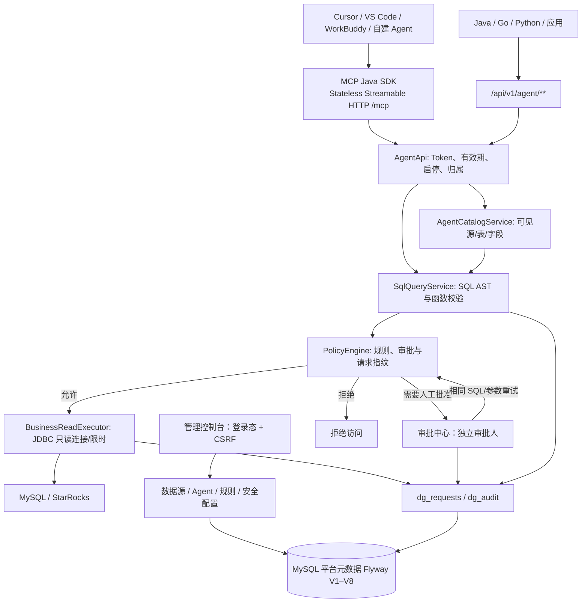

# DataGuard 系统架构

> 以 GitHub `main` 当前代码及 Flyway V1–V8 为准。DataGuard 是 Spring Boot **单体安全网关**，不是跨库查询引擎或分布式调度服务。

## 组件与调用路径

## 后端职责（源码包 `io.github.njgaoyang.dataguard`）

| 模块 | 主要职责 |
|---|---|
| `McpProtocolConfig` | 官方 MCP Java SDK WebMVC HTTP 路由、Origin、Bearer、版本协商、六工具定义 |
| `AgentRestController` | 外部 REST 协议适配，转交相同目录和 SQL 核心 |
| `AgentApi` / `AgentCatalogService` | Agent 管理、Token、有效授权目录 |
| `SqlQueryService` | 严格只读 SELECT AST 验证、同源两表 JOIN、函数白名单、业务参数绑定规划 |
| `PolicyEngine` | 规则优先级、申请、审批、请求状态、二次校验、访问分页和筛选 |
| `BusinessReadExecutor` | 使用物理只读 JDBC 账号连接业务源，超时、最大行数和 PreparedStatement |
| `SourceApi` / `Crypto` | 数据源和授权白名单、受控连接、业务源密码加密 |
| `SecurityControls` | 每 Agent 分钟调用/请求行数额度、账户登录锁定 |
| `Audit` / `SqlAuditTemplate` | 操作审计、查询记录、SQL 字面量脱敏模板 |
| `AuthApi` / `SqlFunctionApi` | 用户角色、会话/CSRF、可配置 SQL 函数 |
| `ApprovalNotifications` | 审批站内通知和运维概览 |

MCP 与 REST 不再各自实现旧 `READ/COUNT/AGGREGATE` 业务路径；它们最终委托相同的 `SqlQueryService`、`PolicyEngine`，只读引擎一处维护。

## 权限边界

- **登录后台的管理者 ≠ 拥有业务源读取权的 Agent。** Agent 只使用自己的 Bearer Token。
- 源启用、平台表/列白名单、Agent 独立授权、所属账号状态与 Token 有效性**全部满足**才有基础读取权限。
- 查询 SQL 的 `SELECT/WHERE/ON/GROUP BY/HAVING/ORDER BY` 引用列都执行 AST 校验，不允许借表达式或 JOIN 越权读取。
- 访问规则 `DENY` 优先于 `APPROVAL`，其次 `ALLOW`；无规则拒绝。
- 同源两表 JOIN 分别形成表级访问请求，任一表被拒绝不得返回整条查询的结果。
- `APPROVED` 会通过数据库事务行锁消费并进入执行状态；完成 JDBC I/O 后再次确认权限和规则，防止执行期撤权后泄露结果。
- 授权 SQL 只读不等于可以无成本扫描：`LIMIT` 只约束返回行数，不承诺限制物理扫描量。大数据源仍需要 DB 侧资源治理。

## 账号、状态、审计

- 人类角色包括 `ADMIN`、`APPROVER`、`READER`。后台需要登录态与 CSRF；外部查询需要 Bearer Agent Token。
- Agent 只显示**启用/已停用**两个运行状态，停用才能编辑授权/删除；删除为逻辑删除，原请求、审计和规则引用可追溯。
- Token 轮换独立于运行状态；旧撤销记录迁移后停止运行且旧 Token 永久失效，再启用签发新 Token。
- `dg_requests` 保存请求身份、指纹、规则、审批及耗时/行数/状态；自 V8 起保存脱敏 SQL 模板；`dg_audit` 保存管理操作及安全事件。
- 不持久化业务查询的完整返回值，也不记录 JDBC 绑定参数明文。**脱敏 SQL 仍含表/字段名称**，应按访问记录权限保护。

## Flyway 元数据版本

| 迁移 | 引入能力 |
|---|---|
| V1 | 用户、源/表/字段、Agent 授权、规则、请求及审计基础结构 |
| V2 | 规则修订及列脱敏 |
| V3 | 登录锁定、分钟额度、审批站内通知 |
| V4 | 安全参数 |
| V5 | 每次 SQL 最大行数参数 |
| V6 | SQL 安全函数白名单及开关 |
| V7 | Agent 已停用/软删除字段、原撤销凭据迁移 |
| V8 | `dg_requests.sql_template` 安全 SQL 模板字段 |

Flyway 升级发生在应用启动时，回滚 JAR **不会**自动撤回 schema。运维须执行备份与向前兼容评估。

## 产品边界与生产缺口

当前是单体进程 + MySQL 共享状态；systemd 可自动恢复进程，但不构成跨机多副本高可用。MCP 传输为**无状态**，没有 SSE 事件流、session resume、OAuth 2.1 授权服务器。生产还需独立的密钥存储、异机恢复演练、可用性告警、对 SQL 扫描成本的治理、外部目标客户端实际验收。

详见 [SQL 安全](SQL_QUERY.md)、[MCP](MCP_INTEROPERABILITY.md)、[运维](OPERATIONS.md)。